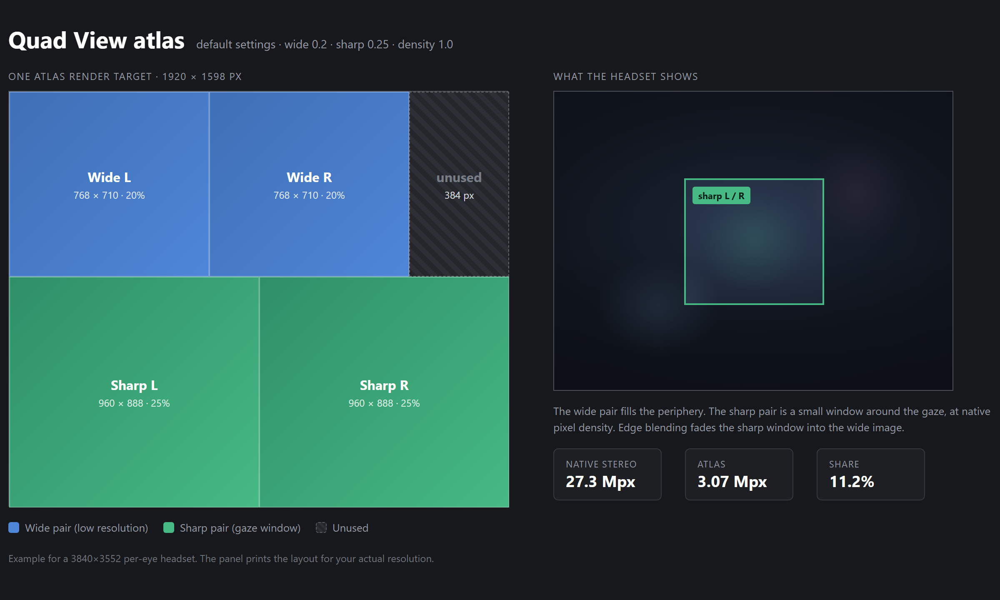
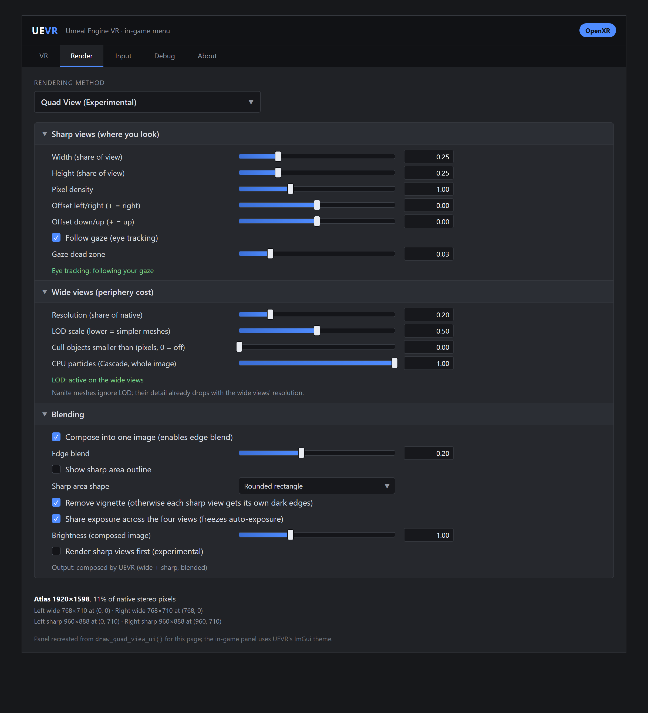

# UEVR Quad View

Universal Unreal Engine VR Mod (4/5) — **experimental Quad View fork** of [JoeyHodge's UEVR](https://github.com/joeyhodge/UEVR).

> Quad View is an opt-in fourth rendering method. Everything else is the regular UEVR backend.
>
> **[Download the test build](https://github.com/Letrange-g/UEVR-QuadView/releases/tag/quadview-ef2dacd)** · **[Upstream PR #42](https://github.com/joeyhodge/UEVR/pull/42)** · **[Full settings and limits](docs/quad-view.md)**

## Supported Engine Versions

4.8 - 5.9

## Links

- [**Download the Quad View test build**](https://github.com/Letrange-g/UEVR-QuadView/releases)
- [Upstream UEVR releases](https://github.com/praydog/UEVR/releases)
- [Upstream nightly release](https://github.com/praydog/UEVR-nightly/releases/latest)
- [Documentation](https://praydog.github.io/uevr-docs)
- [Flat2VR Discord](https://flat2vr.com)

## Quad View (experimental)

Quad View renders four views per frame instead of two:

| View | Covers | Resolution |
| --- | --- | --- |
| Wide L/R | the whole per-eye field of view | 20% of native per eye by default |
| Sharp L/R | a small window around where you look | 25% of the eye, native pixel density |

The wide pair fills the periphery cheaply. The sharp pair is a small window at native density, placed where the eye can resolve detail. UEVR composes all four into one normal stereo image with edge blending, so runtimes do not need to stack projection layers. On OpenXR with eye tracking the window follows your gaze; without eye tracking it stays centred or where the offset sliders put it.

At the default settings the atlas costs about 11% of the pixels of native stereo at 3840×3552. The in-game panel prints the atlas size and share for your actual headset.

### Settings

*The image is a preview of the panel recreated from `draw_quad_view_ui()`; the in-game panel uses UEVR's ImGui theme.*

| Section | Setting | Default | What it does |
| --- | --- | --- | --- |
| Sharp views | Width / Height | 0.25 / 0.25 | Window size as a share of the eye's field of view. |
| Sharp views | Pixel density | 1.00 | Sharp window resolution relative to the headset's native density. |
| Sharp views | Offset left/right, down/up | 0.00 | Moves the window for trackers that sit slightly off-centre. |
| Sharp views | Follow gaze | on | Uses `XR_EXT_eye_gaze_interaction` to place the window. Restart after changing. |
| Sharp views | Gaze dead zone | 0.03 | Tangent units (~1.7°) the gaze must move before the window follows. |
| Wide views | Resolution | 0.20 | Wide view size as a share of the headset's per-eye resolution. |
| Wide views | LOD scale | 0.50 | LOD bias for the wide views. Nanite ignores it. |
| Wide views | Cull objects smaller than | 0 (off) | Sets `foliage.MinimumScreenSize` for the wide views; the sharp area keeps small objects. |
| Wide views | CPU particles | 1.00 | Sets `r.EmitterSpawnRateScale`. Whole-image, so it also thins particles in the sharp window. |
| Blending | Compose into one image | on | Composes the atlas into one stereo image; required for edge blending. |
| Blending | Edge blend | 0.20 | Share of the sharp window that fades into the wide view. |
| Blending | Sharp area shape | Rounded | Rectangle, rounded rectangle or ellipse. Rounded/ellipse need D3D12. |
| Blending | Show sharp area outline | off | Green outline for tuning the window. |
| Blending | Remove vignette | on | Sets `r.Tonemapper.Quality` while Quad View runs, so each sharp view does not get its own dark edges. |
| Blending | Share exposure | on | Freezes auto-exposure so the wide and sharp views keep the same brightness. |
| Blending | Brightness | 1.00 | Multiplier for the composed image; shown when exposure is shared. |
| Blending | Render sharp views first | off | Workaround for games whose Groom hair only draws in the first two views. |
| Debug | Show wide views only / sharp layer only | off | Inspect periphery quality or isolate the sharp layer. |

### How to enable

1. Use the **OpenXR** runtime.
2. In the UEVR menu, set **Rendering Method** to **Quad View (Experimental)**.
3. Start with **D3D12**.
4. Optional eye tracking: enable **Follow gaze** under *Sharp views*, then restart the game.

### Requirements and limits

- **OpenXR.** OpenVR receives only the wide views.
- **UE4** is opt-in (*Allow on Unreal Engine 4*) and should use D3D12. **UE4 + D3D11 is known to crash with four views.**
- **D3D11** composes a rectangular sharp area; the rounded and ellipse shapes need D3D12.
- Depth submission is disabled while Quad View runs because the atlas layout is not the stereo layout the runtime would reproject with.
- Foveated-rendering plugins fight Quad View over the views and render targets; UEVR skips plugins whose file name contains `foveat` when Quad View is selected.
- Quad View turns itself off while Extreme Compatibility Mode, Native Stereo Fix, SceneView compatibility, Splitscreen compatibility or stereo emulation is active.

### Test build

The [release page](https://github.com/Letrange-g/UEVR-QuadView/releases) has `uevr.zip` (injector, backend, nullifier, Lua API and runtime DLLs) and a standalone `UEVRBackend.dll` for existing UEVR installs. The injector needs the **.NET 6 Desktop Runtime**. This is a test build, not an official JoeyHodge or praydog release.

Full documentation: [docs/quad-view.md](docs/quad-view.md)

## Features

- Full 6DOF support out of the box (HMD movement)
- Full stereoscopic 3D out of the box
- Native UE4/UE5 stereo rendering system
- Frontend GUI for easy process injection
- Supports OpenVR and OpenXR runtimes
- 4 rendering modes: Native Stereo, Synchronized Sequential, Alternating/AFR, and experimental Quad View (four views with a gaze-following sharp window, OpenXR)
- Automatic handling of most in-game UI so it is projected into 3D space
- Optional 3DOF motion controls out of the box in many games, essentially emulating a semi-native VR experience
- Optional roomscale movement in many games, moving the player character itself in 3D space along with the headset
- User-authored UI-based system for adding motion controls and first person to games that don't support them
- In-game menu with shortcuts for adjusting settings
- Access to various CVars for fixing broken shaders/effects/performance issues
- Optional depth buffer integration for improved latency on some headsets
- Per-game configurations
- [C++ Plugin system](https://praydog.github.io/uevr-docs/plugins/getting_started.html) and [Blueprint support](https://praydog.github.io/uevr-docs/plugins/blueprint.html) for modders to add additional features like motion controls

## Getting Started

Before launching, ensure you have installed .NET 6.0 SDK. It should tell you where to install it upon first open, but if not, you can [download it from here](https://dotnet.microsoft.com/en-us/download/dotnet/6.0). Most people should click x64 in the top left table, under the Installers column, next to windows.

Download the latest release from the [Releases page](https://github.com/Letrange-g/UEVR-QuadView/releases)

1. Launch UEVRInjector.exe
2. Launch the target game
3. Locate the game in the process dropdown list
4. Select your desired runtime (OpenVR/OpenXR)
5. Toggle existing VR plugin nullification (if necessary)
6. Configure pre-injection settings
7. Inject

## To-dos before injection

1. Disable HDR (it will still work without it, but the game will be darker than usual if it is)
2. Start as administrator if the game is not visible in the list
3. Pass `-nohmd` to the game's command line and/or delete VR plugins from the game directory if the game contains any existing VR plugins
4. Disable any overlays that may conflict and cause crashes (Rivatuner, ASUS software, Razer software, Overwolf, etc...)
5. Disable graphical options in-game that may cause crashes or severe issues like DLSS Frame Generation
6. Consider disabling `Hardware Accelerated GPU Scheduling` in your Windows `Graphics settings`

## In-Game Menu

Press the **Insert** key or **L3+R3** on an XInput based controller to access the in-game menu, which opens by default at startup. With the menu open, hold **RT** for various shortcuts:

- RT + Left Stick: Move the camera left/right/forward/back
- RT + Right Stick: Move the camera up/down
- RT + B: Reset camera offset
- RT + Y: Recenter view
- RT + X: Reset standing origin

## Quick overview of rendering methods

### Native Stereo

When it works, it looks the best, performs the best (usually). Can cause crashes or graphical bugs if the game does not play well with it.

Temporal effects like TAA are fully intact. DLSS/FSR2 usually work completely fine with no ghosting in this mode.

Fully synchronized eye rendering. Works with the majority of games. Uses the actual stereo rendering pipeline in the Unreal Engine to achieve a stereoscopic image.

### Synchronized Sequential

A form of AFR. Can fix many rendering bugs that are introduced with Native Stereo. Renders two frames **sequentially** in a **synchronized** fashion on the same engine tick.

Fully synchronized eye rendering. Game world does not advance time between frames.

Looks normal but temporal effects like TAA will have ghosting/doubling effect. Motion blur will need to be turned off.

This is the first alternative option that should be used if Native Stereo is not working as expected or you are encountering graphical bugs.

**Skip Draw** skips the viewport draw on the next engine tick. Usually works the best but sometimes particle effects may not play at the correct speed.

**Skip Tick** skips the next engine tick entirely. Usually buggy but does fix particle effects and sometimes brings higher performance.

### AFR

Alternated Frame Rendering. Renders each eye on separate frames in an alternating fashion, with the game world advancing time in between frames. Causes eye desyncs and usually nausea along with it.

Not synchronized. Generally should not be used unless the other two are unusable in some way.
